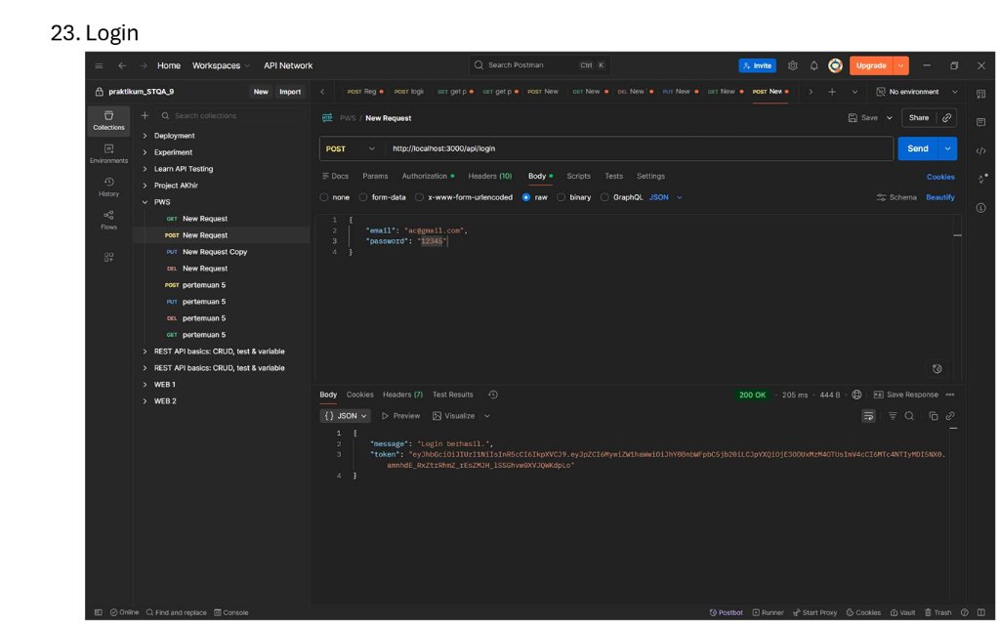

# Pengujian REST API & Autentikasi JWT dengan Postman

Panduan pengujian endpoint API menggunakan Postman sesuai modul praktikum.

---

### 21. Test di Postman

Pastikan server telah dijalankan terlebih dahulu dengan perintah:
```bash
npm start
```
Server berjalan di `http://localhost:3000`.

---

### 22. Register dahulu

Kirim request `POST` ke endpoint `/api/register` untuk mendaftarkan akun user baru.

- **Method**: `POST`
- **URL**: `http://localhost:3000/api/register`
- **Body** (`raw` > `JSON`):
```json
{
  "email": "ac@gmail.com",
  "password": "12345"
}
```
- **Response** (`201 Created`):
```json
{
  "message": "Registrasi berhasil.",
  "data": {
    "id": 3,
    "email": "ac@gmail.com"
  }
}
```


---

### 23. Login

Kirim request `POST` ke endpoint `/api/login` untuk mendapatkan token JWT.

- **Method**: `POST`
- **URL**: `http://localhost:3000/api/login`
- **Body** (`raw` > `JSON`):
```json
{
  "email": "ac@gmail.com",
  "password": "12345"
}
```
- **Response** (`200 OK`):
```json
{
  "message": "Login berhasil.",
  "token": "eyJhbGciOiJIUzI1NiIsInR5cCI6IkpXVCJ9..."
}
```



---

### 24. Copy isi token, paste di bagian authorization pastikan memilih bearer token

Salin token hasil login pada langkah sebelumnya, lalu buka tab **Authorization** pada request yang ingin diproteksi:
1. Pilih **Type**: `Bearer Token`
2. Tempel (*paste*) isi token ke dalam field **Token**


---

### 25. Post komik

Tambahkan data komik baru menggunakan endpoint terproteksi dengan token yang sudah di-set di tab Authorization.

- **Method**: `POST`
- **URL**: `http://localhost:3000/api/komik`
- **Authorization**: `Bearer Token`
- **Body** (`raw` > `JSON`):
```json
{
  "title": "Naruto Uzumaki",
  "author": "Masashi Kishimoto",
  "description": "Komik ninja"
}
```
- **Response** (`201 Created`):
```json
{
  "id": 7,
  "title": "Naruto Uzumaki",
  "description": "Komik ninja",
  "author": "Masashi Kishimoto",
  "updatedAt": "2026-07-27T06:34:00.566Z",
  "createdAt": "2026-07-27T06:34:00.566Z"
}
```


---

### 26. Lanjutkan untuk get komik, put komik, delete komik

Lakukan pengujian untuk operasi CRUD lainnya:

#### A. GET Komik (Menampilkan Semua Komik)
- **Method**: `GET`
- **URL**: `http://localhost:3000/api/komik`
- **Akses**: Publik

#### B. GET Komik by ID (Menampilkan Detail Komik)
- **Method**: `GET`
- **URL**: `http://localhost:3000/api/komik/:id` (contoh: `http://localhost:3000/api/komik/7`)
- **Akses**: Publik

#### C. PUT Komik (Memperbarui Data Komik)
- **Method**: `PUT`
- **URL**: `http://localhost:3000/api/komik/:id`
- **Authorization**: `Bearer Token`
- **Body** (`raw` > `JSON`):
```json
{
  "title": "Naruto Shippuden",
  "author": "Masashi Kishimoto",
  "description": "Kelanjutan petualangan ninja Naruto Uzumaki"
}
```

#### D. DELETE Komik (Menghapus Data Komik)
- **Method**: `DELETE`
- **URL**: `http://localhost:3000/api/komik/:id`
- **Authorization**: `Bearer Token`


